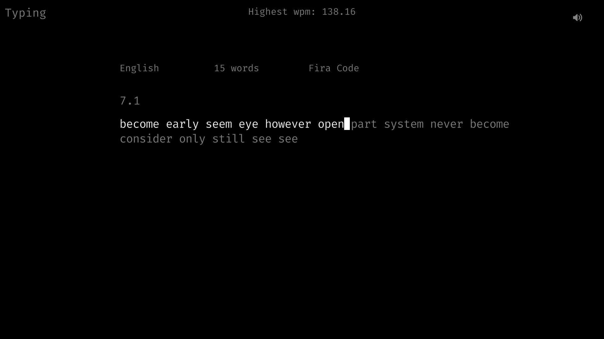

# Typingtest

Install from source
-------------------
#### After installing the dependencies

- [Raylib](https://github.com/raysan5/raylib)
- build-essential

### Clone and Install.

    git clone https://github.com/Soufi-ane/typingtest.git
    cd typingtest
    sudo make install

### Run
    typingtest

--------------------
### Key Mapping (TYPING)

| **Key**                 | **Action**                                         |
|:-----------------------:|----------------------------------------------------|
| `Esc` / `CapsLock`      | Go to `NORMAL` mode                                |           

--------------------
### Key Mapping (NORMAL)

| **Key**                 | **Action**                                                   |
|:-----------------------:|--------------------------------------------------------------|
| `q`                     | Quit                                                         |
| `Esc` / `CapsLock`      | Reload & stay in `NORMAL` mode                               |           
| `r`                     | Reload & and switch to `TYPING` mode                         |
| `f`                     | Switch to next font                                          |
| `+`                     | Increment the number of words                                |
| `-`                     | Decrement the number of words                                |
| `l`                     | Change language mode Normal(200 words),1K words,5k words     |
| `m`                     | Toggle mute (Keyboard sound)                                 |

